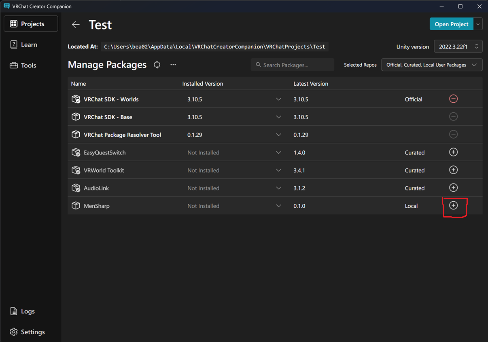
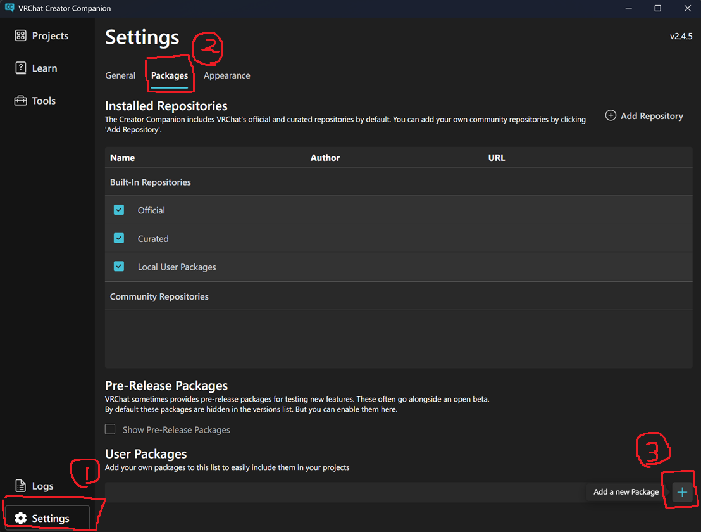
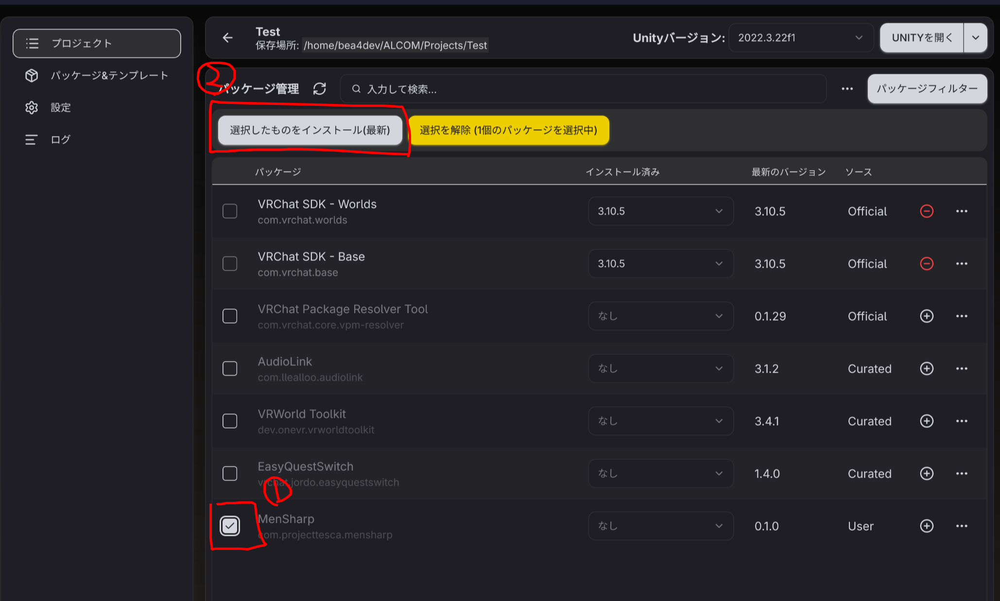
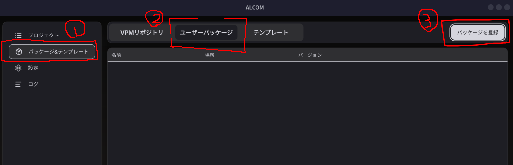

# インストール

VPM リポジトリは次の URL です。

```
https://vpm.tesca.io/vpm.json
```

追加方法は、使っているパッケージマネージャを選んでください。Zip と VPM リポジトリのどちらでも入れられます。

=== "VCC"

    === "VPM リポジトリ"

        `https://vpm.tesca.io/vpm.json` を VPM リポジトリとして追加します。

        

        プロジェクトを新規作成するか、既存プロジェクトの管理画面を開いて MenSharp を追加します。

        

    === "Zip"

        ダウンロードした Zip を展開し、適当な場所に置きます。

        設定のパッケージタブから、展開したフォルダを選択します。

        

        プロジェクトを新規作成するか、既存プロジェクトの管理画面を開いて MenSharp を追加します。

        

=== "ALCOM"

    === "VPM リポジトリ"

        `https://vpm.tesca.io/vpm.json` を VPM リポジトリとして追加します。

        

        プロジェクトを新規作成するか、既存プロジェクトの管理画面を開きます。登録したパッケージをプロジェクトにインストールします。

        

    === "Zip"

        ダウンロードした Zip を展開し、適当な場所に置きます。

        設定のユーザーパッケージタブから、展開したフォルダを選択します。

        

        プロジェクトを新規作成するか、既存プロジェクトの管理画面を開きます。登録したパッケージをプロジェクトにインストールします。

        

追加できたら、[使い方](usage.md)へ進んでください。
