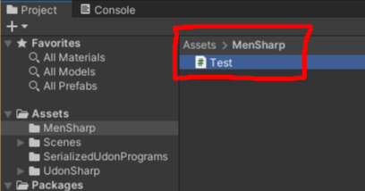
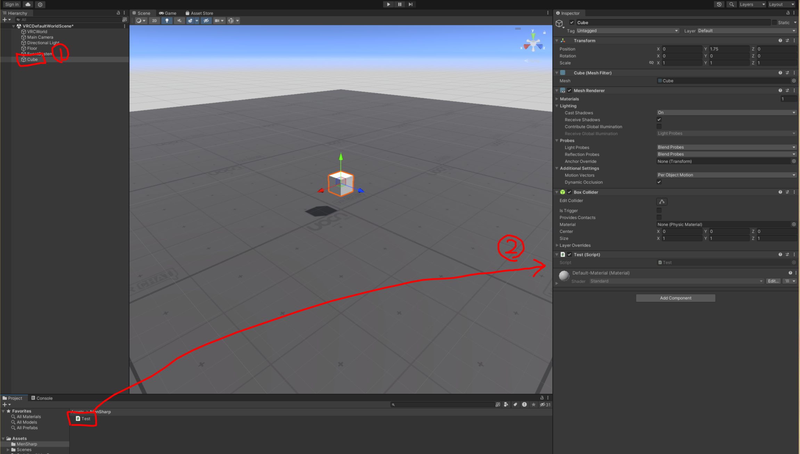
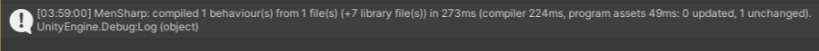
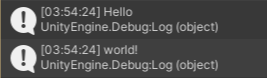

# 使い方

インストールできていれば、プロジェクトを開いた時点で `Assets/MenSharp` ディレクトリが作成されています。

## スクリプトを作成する

`Assets/MenSharp` に C# スクリプト `Test.cs` を作成します。



## コンポーネントを追加する

シーンに Cube を追加し、Inspector に `Test.cs` をドラッグアンドドロップします。



## コードを書く

`Test.cs` を次のように記述します。

```cs title="Test.cs"
using System.Collections.Generic;
using MenSharp;
using UnityEngine;

public class Test : MenSharpBehaviour
{
    public void Interact()
    {
        var list = new List<string> { "Hello", "world!" };
        
        foreach (var value in list) {
            Debug.Log(value);
        }
    }
}
```

!!! warning

    エディタ補完などが使えない場合は、一度スクリプトを保存して Unity を再度フォーカスし直してください。

保存して Unity を再度フォーカスすると、MenSharp のコンパイルが自動で走り、次のように表示されます。



## 動作を確認する

Play ボタンを押して Cube をクリックし、次のように出れば成功です。



ソースコードを保存すると Udon Assembly へ自動でコンパイルされ、ドラッグアンドドロップするだけで登録されます。

パッケージとして配る場合は、[配布](distribution.md)へ進んでください。
