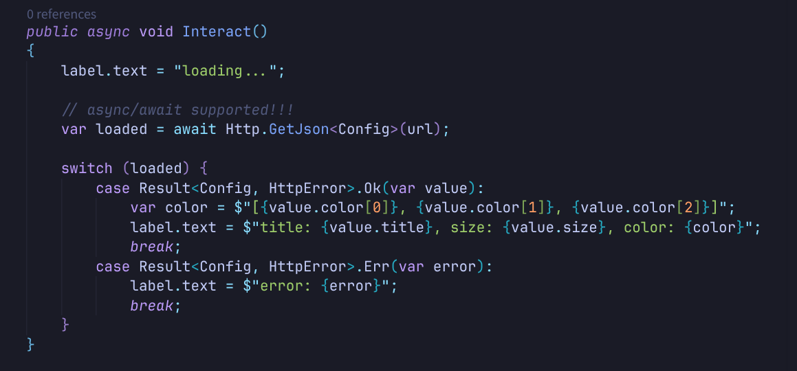

# MenSharp コンパイラ（M#）

C# を Udon Assembly へコンパイルする、世界最速の C# コンパイラです。

MenSharp は Udon Assembly へのコンパイラです。C# 公式の Roslyn コンパイラより、最大 8 倍程度高速にコンパイルできます。

使用できる C# 機能は**ほぼ全て**です。現時点でサポートしていないのは、Thread、lock、FileIO、VRChat SDK を経由しないネットワークアクセスなど、ごく一部の機能だけです。

非対応の機能を使ったコードは、コンパイル時に明示的なエラーになって停止します。実行時エラーにはなりません。

## 読み進める

-   [**インストール**](getting-started/installation.md)

    ---

    VCC または ALCOM に MenSharp を追加します。

-   [**使い方**](getting-started/usage.md)

    ---

    スクリプトを置いて、Cube のクリックまで確認します。

-   [**配布**](getting-started/distribution.md)

    ---

    パッケージの雛形と、ワールドへのアップロードです。

-   [**標準ライブラリ**](stdlib/index.md)

    ---

    HTTP、JSON、`Result` / `Option`、静的リフレクションです。

-   [**言語機能**](language/index.md)

    ---

    async/await、コレクションと LINQ、Behaviour と例外です。

-   [**Q&A**](faq.md)

    ---

    対応プラットフォームとライセンスです。

